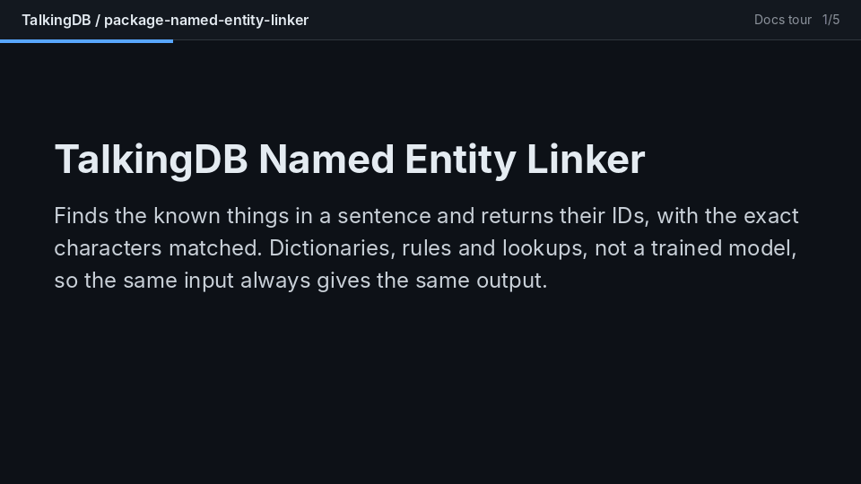

<!-- short-readme -->
<h1 align="center">TalkingDB Named Entity Linker</h1>

<p align="center"><b>Find the known things in a sentence and get their IDs back. No model, no guessing.</b></p>

<p align="center"><a href="#try-it">Try it</a> · <a href="docs/usage-and-examples.md">Usage and examples</a> · <a href="docs/troubleshooting.md">Troubleshooting</a> · <a href="docs/reference.md">Full reference</a></p>

<p align="center"><a href="https://github.com/TalkingDB/package-named-entity-linker/stargazers"></a> <a href="https://www.gnu.org/licenses/agpl-3.0.html"></a></p>

<p align="center">
  
</p>
<p align="center"><sub>A real run at <code>c4a9ef2</code> on 27 Nov 2026, in process with no server: 361 entities and 4,013 surface texts, two queries, each answered in 1 ms or less. Every match comes back with its span. (<code>smart_slugify</code>, which only builds internal ids, was a stand-in in that sandbox.) The API steps are in <a href="docs/usage-and-examples.md">Usage and examples</a>.</sub></p>

Give it "stainless hex nut M8" and it returns each phrase's entity, the exact characters it matched, and whether a spelling was corrected. It works from dictionaries and rules, so the same text always gives the same answer and every match traces back to a [surface text](https://github.com/TalkingDB/ConceptDigger/blob/master/docs/concepts.md#surface-texts-every-name-for-a-thing). That is [named entity linking](https://en.wikipedia.org/wiki/Entity_linking), not recognition.

## What it does

- **Train** a [namespace](docs/usage-and-examples.md#1-create-a-namespace) with entities and every way people write them, plus [regex rules](docs/usage-and-examples.md#3-add-a-regex-rule-optional) for patterns such as thread sizes.
- **Extract**: one call returns every match with its span, its spelling correction and its entity ([example](docs/usage-and-examples.md#5-extract-from-text)).
- **Test and roll back**: save [test cases](docs/usage-and-examples.md#6-save-test-cases), [commit snapshots](docs/usage-and-examples.md#4-commit-a-snapshot) and [roll back](docs/usage-and-examples.md#8-roll-back) a change that makes things worse.

## Try it

```bash
make sync MODE=git     # wires in the three base-tdb-* repositories
poetry install --with dev
make local             # API on http://localhost:8092, Swagger at /docs
```

No server needed for a quick test: [use NEL in process](docs/usage-and-examples.md#use-nel-in-process-without-a-server).

## Where it fits

[package-parse-tree](https://github.com/TalkingDB/package-parse-tree) asks NEL which known things a query contains; names often come from [ConceptDigger](https://github.com/TalkingDB/ConceptDigger); built on [base-tdb-models](https://github.com/TalkingDB/base-tdb-models), [base-tdb-clients](https://github.com/TalkingDB/base-tdb-clients) and [base-tdb-helpers](https://github.com/TalkingDB/base-tdb-helpers).

## Learn more

| Page | Read it to |
| :--- | :--- |
| [Usage and examples](docs/usage-and-examples.md) | copy working examples |
| [Troubleshooting](docs/troubleshooting.md) | fix a problem |
| [Full reference](docs/reference.md) | read everything that used to be on this page |
| [All docs](docs/README.md) | see every page |

## Support TalkingDB

If package-named-entity-linker saved you time, please [give it a star](https://github.com/TalkingDB/package-named-entity-linker) ⭐. Stars help other developers find the project.

Found a bug, or a document it gets wrong? [Open an issue](https://github.com/TalkingDB/package-named-entity-linker/issues/new). We are always here to help and open to a conversation. Explore the TalkingDB applications at [talkingdb.io](https://talkingdb.io/#applications).

## License

GNU Affero General Public License v3.0 ([AGPL-3.0](https://www.gnu.org/licenses/agpl-3.0.html)). See [LICENSE](LICENSE).
