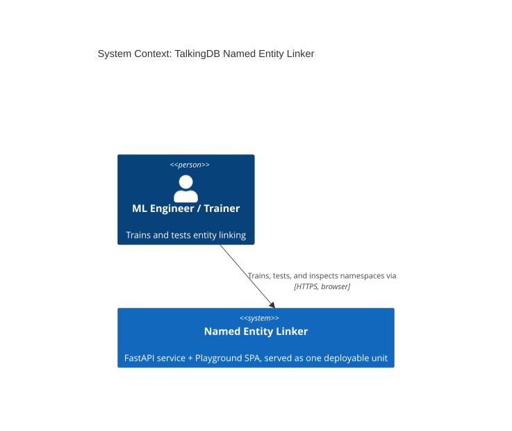

<h1 align="center">TalkingDB Named Entity Linker</h1>
<p align="center">
  
</p>

<p align="center">
  
  
  
  
</p>

<p align="center">
  
  
  <a href="https://github.com/TalkingDB/package-named-entity-linker/actions/workflows/workflow.yml">
    
  </a>
  <a href="https://codecov.io/gh/TalkingDB/package-named-entity-linker">
    
  </a>
  
  
  
</p>

---

<h3 align="center">Symbolic Named Entity Linking for canonical entity resolution</h3>

TalkingDB Named Entity Linker (NEL) finds the known things in a sentence and returns their IDs. Given "stainless hex nut M8", it answers with the entity each phrase belongs to, the exact characters it matched, and whether a spelling correction was needed. It does this with dictionaries, rules and lookups, not with a trained model, so the same input always gives the same output and every match can be traced to the [surface text](https://github.com/TalkingDB/ConceptDigger/blob/main/docs/concepts.md#surface-texts-every-name-for-a-thing) that produced it.

Two terms are easy to mix up. **Named entity recognition (NER)** says "this word is an ingredient". **Named entity linking (NEL)** says "this word is entity `INS-955`", a row you can open and edit. This service does the second.

| Start here | Go deeper |
| :--- | :--- |
| [How matching works](#how-matching-works) | [Usage and examples: every API call, step by step](docs/usage-and-examples.md) |
| [Getting started](#getting-started) | [Architecture (C4 views)](docs/architecture/README.md) |
| [API at a glance](#api-at-a-glance) | [Decision records](docs/adrs/README.md) |
| [What NEL is not](#what-nel-is-not) | [Troubleshooting](docs/troubleshooting.md) |

All pages: [docs/](docs/README.md).

---

## Architecture

<p align="center">
    
</p>

### System Context (C4)

<picture>
  <source media="(prefers-color-scheme: dark)" srcset="docs/images/readme-diagram-dark.svg">
  
</picture>

<sub>Diagram source: [readme-diagram.mmd](docs/diagrams/readme-diagram.mmd). Edit it and re-render with the steps in [docs/diagrams](docs/diagrams/README.md).</sub>

In words: one person trains and tests through a browser or HTTP, and NEL is a single deployable unit holding both the API and the Playground app. See [`docs/architecture/`](docs/architecture/README.md) for the Container and Component views, and [`docs/adrs/`](docs/adrs/README.md) for the reasoning behind them.

## How matching works

<picture>
  <source media="(prefers-color-scheme: dark)" srcset="docs/images/nel-extraction-pipeline-dark.svg">
  
</picture>

<sub>Diagram source: [nel-extraction-pipeline.mmd](docs/diagrams/nel-extraction-pipeline.mmd). Edit it and re-render with the steps in [docs/diagrams](docs/diagrams/README.md).</sub>

In words: trained phrases and words are matched first, regex rules second, and anything left over is lemmatized and matched again, optionally allowing one typo; every token ends up as a linked entity, a regex hit, or a "no tag" token. The code is in [`services/entity/entity.py`](talkingdb_nel/services/entity/entity.py) (`get_surface_texts`) and [`services/symbolic/`](talkingdb_nel/services/symbolic/).

| Technique | Plain meaning |
| :--- | :--- |
| Phrase matching | "hexagon full nut" is read as one thing, not three weak guesses |
| Word matching | Single words matched against the dictionary |
| Regex matching | Precise patterns such as `M4` or `1.50 pitch` |
| [Lemmatization](https://en.wikipedia.org/wiki/Lemmatisation) | "nuts" and "nut" reach the same entry |
| Fuzzy correction | "haxagon" reaches "hexagon", one [edit](https://en.wikipedia.org/wiki/Levenshtein_distance) away |

**Namespaces** keep each customer's dictionary separate. **Commits** snapshot a namespace so you can test against it and roll back; a rollback is recorded as a new commit. The **test suite** runs saved test cases against the live pipeline and labels each one, which gives an accuracy figure per run.

## API at a glance

Five resource groups, all under `/api/namespaces`:

| Group | Base path | What it is for |
| :--- | :--- | :--- |
| Namespaces | `/api/namespaces` | Create, list, commit, roll back, view the graph |
| Entities | `/api/namespaces/{namespace}/entities` | Add entities, surface texts and regex rules, one at a time or in bulk |
| Facts | `/api/namespaces/{namespace}/facts` | Typed links between entities |
| Extraction | `/api/namespaces/{namespace}/extractions` | Run the pipeline on text |
| Test suite | `/api/namespaces/{namespace}/test-cases`, `/test-runs` | Save expected matches and score runs |

Full request and response examples are in [docs/usage-and-examples.md](docs/usage-and-examples.md). A running instance serves interactive Swagger docs at `/docs`. Release history is in [CHANGELOG.md](CHANGELOG.md).

## Getting Started

You need Python 3.12 or 3.13, [Poetry](https://python-poetry.org/docs/#installation), and the three `base-tdb-*` repositories, which `make sync` wires in for you.

```bash
poetry install --with dev
make local
```

- **API base URL:** `http://localhost:8092`
- **Swagger docs:** `http://localhost:8092/docs`
- **Playground:** `http://localhost:8092/` once `playground/dist` exists

> [!IMPORTANT]
> `make local` starts [uvicorn](https://www.uvicorn.org/) with `--reload-dir ../base-tdb-models` (and clients, helpers), so it expects those repositories checked out next to this one. Use `make sync MODE=local` while editing them side by side, and `make sync MODE=git` before you commit.

Or run it in a container:

```bash
docker build -t talkingdb-nel .
docker run -p 8092:8092 talkingdb-nel
```

## Development

```bash
make format
make lint
make test
make coverage
make check
```

The Playground's built files in `playground/dist` are committed, not built in CI. After changing `playground/src`, run `npm run build` in `playground/` and commit the result, or the served UI stays on the old version.

## Project Structure

```text
talkingdb_nel/
├── api/            # FastAPI routers: namespaces, entities, facts, extraction, test suite
├── services/
│   ├── entity/     # Entity, fact and regex rule service layer
│   ├── namespace/  # Namespace registry, store and commit versioning
│   ├── symbolic/   # Tokenizer, lemmatizer, matchers, regex controller
│   └── testsuite/  # Test cases, bulk upload, runner
└── main.py
playground/         # React + Vite training UI, served by FastAPI from playground/dist
```

## What NEL is not

- **Not a machine learning model.** Nothing is trained by gradient descent; matches come from the dictionary you build.
- **Not an [ontology](https://en.wikipedia.org/wiki/Ontology_(information_science)) engine.** NEL says which known things are in a sentence. Categories, instances and attributes are worked out by [package-parse-tree](https://github.com/TalkingDB/package-parse-tree), which calls NEL.
- **Not a tie breaker.** When one surface text belongs to two entities, both are returned. Keep surface texts unique per namespace, or let the caller decide.
- **Not a document reader.** Turning PDFs into text is [package-content-elementizer](https://github.com/TalkingDB/package-content-elementizer) and [module-ttt](https://github.com/TalkingDB/module-ttt).

---

## Linked Repositories

| **Repository** | **Role** |
| :--- | :--- |
| [`base-tdb-models`](https://github.com/TalkingDB/base-tdb-models) | Shared data models (entity graph, dictionary, regex rules) used across TalkingDB services. |
| [`base-tdb-clients`](https://github.com/TalkingDB/base-tdb-clients) | [SQLite](https://www.sqlite.org/about.html) connections for `ENTITY_DB`, `DICTIONARY_DB` and `REGEX_DB`. |
| [`base-tdb-helpers`](https://github.com/TalkingDB/base-tdb-helpers) | Shared utility layer and the `make sync` dependency tool. |
| [`package-parse-tree`](https://github.com/TalkingDB/package-parse-tree) | Calls NEL over HTTP (`NEL_SERVER`) to train ontology synonyms and extract entities. |
| [`ConceptDigger`](https://github.com/TalkingDB/ConceptDigger) | Harvests synonyms from [DBpedia](https://www.dbpedia.org/about/) that can be trained into NEL as surface texts. |
| [`infra-tdb-platform`](https://github.com/TalkingDB/infra-tdb-platform) | Multi-repo orchestration tooling (`tdbcli`) and infrastructure for the platform. |

## Further reading

- [Entity linking](https://en.wikipedia.org/wiki/Entity_linking) and [named entity recognition](https://en.wikipedia.org/wiki/Named-entity_recognition)
- [The C4 model for software architecture](https://c4model.com/)
- [FastAPI documentation](https://fastapi.tiangolo.com/)
- [Documenting architecture decisions](https://cognitect.com/blog/2011/11/15/documenting-architecture-decisions) (the ADR format used in `docs/adrs/`)

---

## License

GNU Affero General Public License v3.0 ([AGPL-3.0](https://www.gnu.org/licenses/agpl-3.0.html)). See [LICENSE](LICENSE).

## Maintainer

**Mayank Gupta**
[mayank.g@smarter.codes](mailto:mayank.g@smarter.codes)

<p align="center">
  <a href="https://talkingdb.io/">
    
  </a>
  <a href="https://www.linkedin.com/company/talkingdb/about/">
    
  </a>
  <a href="mailto:hello@talkingdb.io">
    
  </a>
</p>
