# Usage and examples

[Docs home](README.md) › Usage and examples

A walk through the API from an empty service to a scored test run. Every path below is taken from the routers in [`talkingdb_nel/api/`](../talkingdb_nel/api/). For what happens inside an extraction, see [How matching works](../README.md#how-matching-works).

The examples assume the service runs locally on port 8092 (`make local`). Set a shell variable to save typing:

```bash
NEL=http://localhost:8092
```

<picture>
  <source media="(prefers-color-scheme: dark)" srcset="images/typical-nel-workflow-dark.svg">
  
</picture>

<sub>Diagram source: [typical-nel-workflow.mmd](diagrams/typical-nel-workflow.mmd). Edit it and re-render with the steps in [docs/diagrams](diagrams/README.md).</sub>

In words: build a namespace, snapshot it, try it on text, lock the behaviour in with test cases, and roll back when a change makes things worse.

## 1. Create a namespace

A **namespace** is one separate dictionary, usually one per customer or domain.

```bash
curl -s -X POST "$NEL/api/namespaces" \
  -H "Content-Type: application/json" \
  -d '{"name": "fasteners", "description": "Nuts, bolts and washers"}'
```

The response holds `name`, `description` and `created_at`. List them with `GET /api/namespaces`.

## 2. Add entities and their surface texts

An **entity** has an `entity_id`, a `label` and `surface_texts`, the ways people write it.

```bash
curl -s -X POST "$NEL/api/namespaces/fasteners/entities" \
  -H "Content-Type: application/json" \
  -d '{"entity_id": "hex_nut", "label": "Hex nut", "surface_texts": ["hex nut", "hexagon nut"]}'

curl -s -X POST "$NEL/api/namespaces/fasteners/entities/hex_nut/surface-texts" \
  -H "Content-Type: application/json" \
  -d '{"surface_text": "hex full nut"}'
```

For many entities at once, send a CSV or JSON file's content to `POST /api/namespaces/{namespace}/entities/bulk` with `{"format": "csv", "content": "..."}`. The response counts what was `created` and lists `errors` per row.

> [!WARNING]
> Keep each [surface text](https://github.com/TalkingDB/ConceptDigger/blob/master/docs/concepts.md#surface-texts-every-name-for-a-thing) on one entity. If "dome" belongs to two entities, extraction returns both, and the caller has to choose. Check your source file for duplicates before a bulk upload.

## 3. Add a regex rule (optional)

Regex rules catch patterns a dictionary cannot list, such as thread sizes.

```bash
curl -s -X POST "$NEL/api/namespaces/fasteners/entities/thread_size/regex-rules" \
  -H "Content-Type: application/json" \
  -d '{"regex": "\\bM[0-9]{1,2}\\b"}'
```

Rules are compiled case insensitive. Edit one with `PATCH .../regex-rules` (`old_regex`, `new_regex`) and remove one with `DELETE .../regex-rules` (`regex`).

## 4. Commit a snapshot

```bash
curl -s -X POST "$NEL/api/namespaces/fasteners/commits" \
  -H "Content-Type: application/json" \
  -d '{"message": "First fastener vocabulary"}'
```

The response gives a `commit_id` and its `parent_commit_id`. `GET /api/namespaces/fasteners/commits` lists the history.

## 5. Extract from text

```bash
curl -s -X POST "$NEL/api/namespaces/fasteners/extractions" \
  -H "Content-Type: application/json" \
  -d '{"message_text": "need 20 haxagon nuts M8", "word_correction": true}'
```

The response has three lists. Their fields are defined in [`api/extraction.py`](../talkingdb_nel/api/extraction.py):

| List | One item means | Fields |
| :--- | :--- | :--- |
| `universal_entities` | A span matched a trained surface text, exactly or with a correction | `index` (start and end character), `surface_text` (as written), `corrected_text` (dictionary form), `score` (0 exact, below 0 corrected), `entities` (each with `entity_id`, `label`, `surface_text`) |
| `regex_entities` | A span matched a regex rule | `index`, `surface_text`, `rule` (the owning entity), `regex`, `meronyms` |
| `no_tag_entities` | A token matched nothing | `index`, `surface_text` |

The shape of a successful response is pinned by [`tests/unit/api/test_extraction.py`](../tests/unit/api/test_extraction.py), for example:

```json
{
  "universal_entities": [
    {
      "index": [0, 5],
      "surface_text": "apple",
      "corrected_text": "apple",
      "score": 0,
      "entities": [{"entity_id": "Q1", "label": "Apple", "surface_text": "apple"}]
    }
  ],
  "regex_entities": [],
  "no_tag_entities": []
}
```

> [!TIP]
> With `word_correction` off, only exact (and [lemmatized](https://en.wikipedia.org/wiki/Lemmatisation)) forms match. Turn it on for user typed queries; leave it off when you need to know that a phrase appears exactly.

## 6. Save test cases

A **test case** is a message plus the matches you expect.

```bash
curl -s -X POST "$NEL/api/namespaces/fasteners/test-cases" \
  -H "Content-Type: application/json" \
  -d '{"message_text": "hexagon nut", "word_correction": false,
       "expected": [{"surface_text": "hexagon nut", "entity_id": "hex_nut"}]}'
```

Cases can also be bulk uploaded (`POST .../test-cases/bulk`), and accepted or rejected after review (`POST .../test-cases/{id}/accept`, `.../reject`).

## 7. Run the tests

```bash
curl -s -X POST "$NEL/api/namespaces/fasteners/test-runs" \
  -H "Content-Type: application/json" -d '{}'
```

`GET .../test-runs/{run_id}` returns every result with a `status_label` of `pass`, `regression`, `fixed`, `fail`, `new` or `needs_review`, plus `accuracy`, `graded_count`, `passed_count` and `total_count`.

> [!IMPORTANT]
> Quote `accuracy` together with `passed_count` and `graded_count`. A percentage without its denominator cannot be checked.

## 8. Roll back

```bash
curl -s -X POST "$NEL/api/namespaces/fasteners/commits/<commit_id>/rollback"
```

The rollback restores that snapshot and records itself as a new commit named `Rollback to <first 8 characters>`, so history is never erased.

## Use NEL in process, without a server

Other services and scripts can call the same function the API calls. The [SQLite](https://www.sqlite.org/about.html) connections open when `talkingdb_nel` is imported, so set the database paths first:

```python
import os
os.environ["ENTITY_DB"] = "/tmp/nel/entities.db"
os.environ["DICTIONARY_DB"] = "/tmp/nel/dictionary.db"
os.environ["REGEX_DB"] = "/tmp/nel/regex.db"

from talkingdb_nel.services.entity.entity import get_surface_texts
```

```python
from talkingdb_nel.services.namespace.registry import registry

bundle = registry.get("fasteners")   # the namespace must already exist
result = get_surface_texts(bundle, message_text="hexagon nut", word_correction=False)
```

The registry is in [`services/namespace/registry.py`](../talkingdb_nel/services/namespace/registry.py). On Windows the SQLite files stay open until the process exits, so delete temporary folders on a best effort basis.

## Use the Playground

The [React](https://react.dev/learn) app in [`playground/`](../playground/) is served by the API at `/` when `playground/dist` exists. It has views for training, tests, history, the entity graph and code samples. To work on it:

```bash
cd playground
npm install
npm run dev      # Vite dev server
npm run build    # writes playground/dist, which is committed
```

## Further reading

- [FastAPI: request bodies](https://fastapi.tiangolo.com/tutorial/body/)
- [curl manual](https://curl.se/docs/manual.html)
- [Regular expressions in Python](https://docs.python.org/3/library/re.html)

---

**Related:** [Troubleshooting](troubleshooting.md) · [Architecture Decision Records](adrs/README.md) · [Architecture (C4 model)](architecture/README.md) · [README](../README.md)
